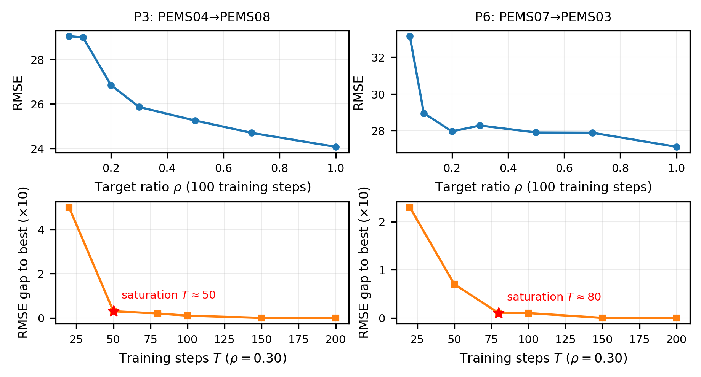

# PAD-TF

<div align="center">

**Probe-based Adaptive Domain Transfer for Cost-aware Cross-domain Traffic Forecasting**

[](https://www.python.org/)
[](https://pytorch.org/)
[](https://github.com/HKUDS/FlashST)
[](#tests)

Cost-aware model management for deciding **whether to adapt**, **how much target data to use**, and **how long to fine-tune** before full target-domain training begins.

</div>



## Overview

Cross-domain traffic forecasting normally applies one fixed adaptation recipe to every new target domain. PAD-TF instead uses inexpensive evidence collected before large-scale target training:

1. **Static signals** describe source-target differences in sensor scale, traffic statistics, and graph topology.
2. **Dynamic signals** measure the source model's zero-shot error and the gain from a lightweight target-domain probe.
3. **Cost-aware selection** estimates the utility of **Direct**, **Fine-tune**, and **Retrain**. When fine-tuning is selected, PAD-TF also chooses the target-data ratio and epoch budget.

The implementation runs on the official [FlashST](https://github.com/HKUDS/FlashST) pipeline, pinned to commit `39d4b8e445fde7ed5272151f7e74752d2c84c58e`, with an STGCN backbone.

## Repository layout

```text
PAD-TF/
├── configs/              # Paper protocol and experiment settings
├── padtf/                # Core signals, selectors, policies, runner, aggregation
├── scripts/              # Setup and reproducibility entry points
├── tests/                # Unit tests
├── tools/                # Utility scripts
├── docs/DATASETS.md      # Dataset sources and expected file layout
└── requirements.txt      # Python dependencies beyond PyTorch
```

Large datasets, upstream code, checkpoints, logs, and generated results are intentionally excluded from version control.

## Experimental protocol

| Pair | Source | Target |
|---|---|---|
| P1 | METR-LA | PEMS-BAY |
| P2 | PEMS-BAY | METR-LA |
| P3 | PEMS04 | PEMS08 |
| P4 | PEMS08 | PEMS04 |
| P5 | PEMS03 | PEMS07 |
| P6 | PEMS07 | PEMS03 |
| P7 | PEMS07 | LargeST-CA |
| P8 | LargeST-CA | PEMS07 |

P7/P8 use the FlashST-compatible 211-sensor `CA_District5` subset, not the full 8,600-sensor LargeST-CA dataset. All experiments use 12 historical and 12 forecasting steps at five-minute resolution. The paper matrix uses seeds `2024`, `2025`, and `2026`.

The principal utility is the relative RMSE reduction over Direct minus `0.3 ×` target-domain cost normalized by Retrain. Each run records metrics, timing, selected budgets, configuration hashes, checkpoint hashes, and the pinned upstream revision.

## Installation

### Option A: automated Linux setup

The bootstrap script creates a Conda environment, checks out the pinned FlashST revision, downloads the public datasets, and validates the setup:

```bash
git clone https://github.com/cuixiaoxi99/PAD-TF.git
cd PAD-TF
bash scripts/bootstrap_remote.sh
conda activate padtf
python -m padtf.cli doctor
```

Set `CONDA_BIN`, `PADTF_ENV_NAME`, or `PYTHON_BIN` before running the script if your setup is nonstandard.

### Option B: existing Python environment

Python 3.10 and PyTorch 2.1 with CUDA 12.1 were used for the paper experiments.

```bash
pip install -r requirements.txt
git clone https://github.com/HKUDS/FlashST.git third_party/FlashST
git -C third_party/FlashST checkout 39d4b8e445fde7ed5272151f7e74752d2c84c58e
python -m padtf.cli doctor
```

See [docs/DATASETS.md](docs/DATASETS.md) for dataset provenance and the expected directory structure.

## Quick start

Run PAD-TF for one transfer pair, or run all methods for that pair:

```bash
python -m padtf.cli run --pair P3 --seed 2024 --method PAD-TF
python -m padtf.cli run-pair --pair P3 --seed 2024
```

Outputs are written to `results/runs/` and `results/tables/`; logs and checkpoints go to `logs/` and `checkpoints/`. Completed JSON runs are skipped unless `--force` is supplied.


## Acknowledgements

PAD-TF builds on the official [FlashST](https://github.com/HKUDS/FlashST) implementation and uses public traffic datasets released by FlashST, DCRNN, and Zenodo contributors.
